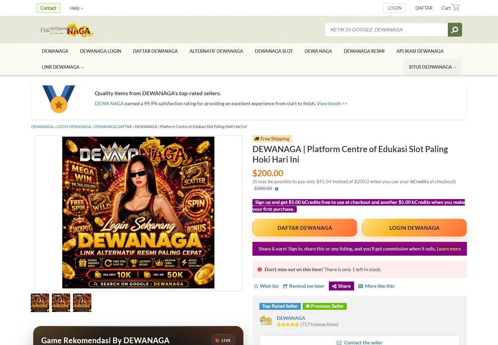
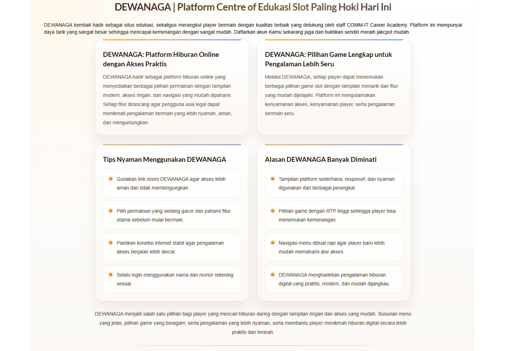

# Browser screenshots

These are unannotated screenshots of live public pages captured with Microsoft Edge through Playwright. They are a separate follow-up observation from the eight original source/archive responses.

Exact UTC capture times, browser version, response status, final URLs and allowed/blocked requests are recorded in [`browser-capture.json`](captures/browser-initial/browser-capture.json). Screenshot hashes and the hashes of their accompanying HTML/headers are in [`SHA256SUMS`](captures/browser-initial/SHA256SUMS).

| ID | Screenshot | Capture time (UTC) | SHA-256 |
|---|---|---|---|
| S1 | `root-viewport.png` | 2026-11-09 18:48:24 | `b1e7e9541e6c0fe8e564c72e73a352b6e93a3b7fee0dd497f274122f9966fa40` |
| S2 | `root-promotion.png` | 2026-11-09 18:48:25 | `74af5bac744e377e5683b4c1ed93430c2f33b6d5e42d8acc8e4c85c7656304ad` |
| S3 | `home-viewport.png` | 2026-11-09 18:48:29 | `0fc3abe0bf8eeb4a867ae19752bf269c16252c6ab758fc6a0c47d3a5627dfd03` |

Both document requests returned HTTP 200 at the requested URLs. The root's browser-response body has the same SHA-256 as E1; the home-page body has its own recorded hash. Capture times reflect the research machine's clock and are not independently certified timestamps.

## Capture settings

- Viewport: **1440 × 1000**, device scale factor 1; headless browser, locale `en-GB`, timezone UTC.
- Page-authored JavaScript and service workers were disabled. Each page used a fresh browser context without an existing login or browsing profile.
- Navigation was limited to the two exact document URLs. GET requests for images, stylesheets and fonts were allowed only from `commit.org.in`, `assets.bonanza.com`, `i.imgur.com`, `fonts.googleapis.com` and `fonts.gstatic.com`.
- Other page requests were blocked. No login, registration, gambling destination, form submission or download was triggered.
- These restrictions can affect fonts, images, carousels and layout. The screenshots demonstrate the captured restricted-browser view, not every visitor's experience or the site's JavaScript-enabled behaviour.
- No annotations, compositing or image generation were applied. The promotional-detail screenshot was obtained by scrolling the same live root page to its heading.

## S1 — root page, initial viewport

Source: `https://commit.org.in/`. The screenshot begins at the top of the document; the browser address bar is not part of a page screenshot. The final URL and document title are recorded in the metadata.



## S2 — root page, promotional text

Source: `https://commit.org.in/`, scrolled to the DEWANAGA promotional heading. The institutional-support text is a claim made by the page, not a verified endorsement.



## S3 — academy home page, initial viewport

Source: `https://commit.org.in/home.html`. The academy branding provides a visual comparison with the root page. JavaScript-driven sliders may differ from their normal interactive presentation.


## Verify or reproduce

Verify the saved bundle offline:

```powershell
.\verify.ps1 -CaptureDirectory .\captures\browser-initial
```

```bash
bash verify.sh captures/browser-initial
```

To capture a later observation, use Python with Playwright installed and an installed Chromium-family browser:

```powershell
python capture-screenshots.py captures/browser-follow-up "C:\Program Files (x86)\Microsoft\Edge\Application\msedge.exe"
```

The output directory must be new. Preserve earlier screenshots and record changed content as a new observation rather than overwriting evidence.
